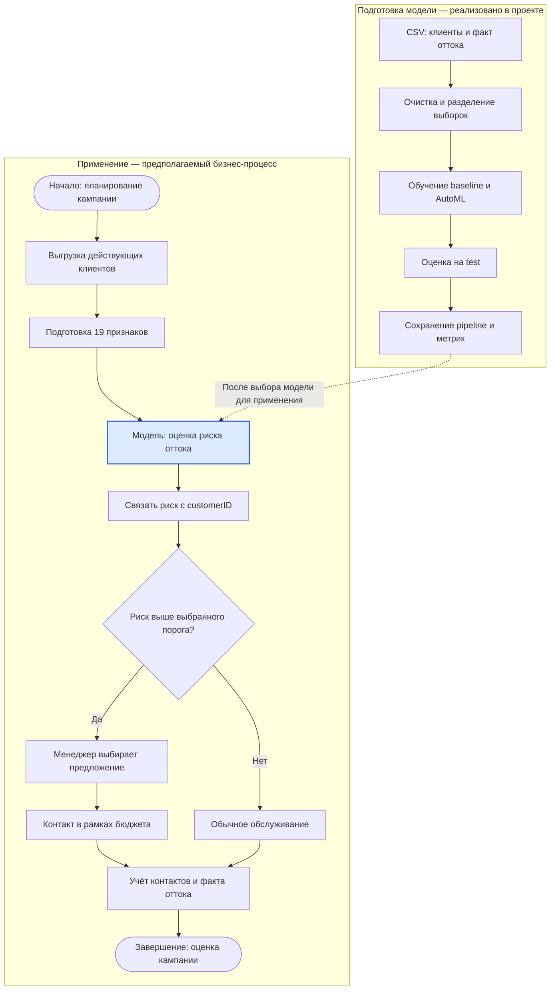

# Место модели в процессе удержания клиентов

Цель процесса — заранее выделить клиентов с повышенным риском оттока и помочь команде удержания направить ограниченный бюджет на подходящие контакты.

Ниже приведена упрощённая схема процесса в Mermaid: начало и завершение, действия и развилка решения. Это диаграмма для документации, а не исполняемый файл BPMN 2.0. Верхний блок отражает реализованное обучение; нижний — предполагаемое использование модели в бизнесе. CRM-интеграция и кампании в текущем проекте не реализованы.

## Какую задачу решает модель

Модель превращает сведения о клиенте в оценку риска оттока. Она находится между подготовкой клиентских данных и решением о контакте. Такой скоринг помогает ранжировать клиентов; выбор предложения и выделение бюджета выполняются на следующем этапе.

На схеме используется выбранный для применения обученный pipeline. В эксперименте AutoML выбрал Random Forest, однако baseline показал более высокий Recall. Поэтому само имя `best_model.joblib` не является основанием автоматически внедрять этот вариант: перед пилотом нужно сравнить модели по бизнес-критериям.

## Почему здесь целесообразен ML

Есть исторические примеры клиентов с известным исходом `Churn`, а риск зависит от сочетания договора, срока обслуживания, платежей и услуг. ML позволяет обучиться этим сочетаниям и выдавать единообразную оценку для большого списка клиентов. Оценку можно сравнить с простыми правилами и использовать для приоритизации при ограниченном бюджете.

При этом прогноз оттока не показывает, кого удастся удержать конкретным предложением. Дополнительный эффект кампании нужно проверять отдельно, например сравнением с контрольной группой.

## Какие данные поступают на вход

Во время обучения используется `data/telco_customer_churn.csv`: 7043 строки, целевая переменная `Churn` и клиентские признаки. Часть данных выделяется для validation и test.

В предполагаемом рабочем процессе источник — выгрузка действующих клиентов из CRM и биллинга. В модель поступают те же **19 признаков**, что при обучении:

- демография: `gender`, `SeniorCitizen`, `Partner`, `Dependents`;
- срок обслуживания: `tenure`;
- услуги: `PhoneService`, `MultipleLines`, `InternetService`, `OnlineSecurity`, `OnlineBackup`, `DeviceProtection`, `TechSupport`, `StreamingTV`, `StreamingMovies`;
- договор и оплата: `Contract`, `PaperlessBilling`, `PaymentMethod`;
- платежи: `MonthlyCharges`, `TotalCharges`.

`Churn` у новых клиентов неизвестен и не передаётся. `customerID` сохраняется отдельно для привязки результата. До скоринга `TotalCharges` приводится к числу, после чего сохранённый pipeline заполняет пропуски и кодирует категории. Состав и типы колонок должны совпадать с обучением; признаки должны быть доступны на момент прогноза.

## Как используется результат

1. Для каждого клиента берётся оценка вероятности класса `Yes` и связывается с его `customerID`.
2. Клиенты ранжируются по риску. Порог выбирается заранее на validation-данных с учётом стоимости ошибок и бюджета; в текущем проекте бизнес-порог не настроен.
3. Менеджер рассматривает клиентов выше порога и выбирает подходящее действие: поддержку, предложение тарифа или скидку. При недостатке бюджета приоритет получают кандидаты с более высоким риском.
4. Для оценки кампании сохраняются факт контакта, затраты и последующий исход. В пилоте сравниваются отток и экономический результат с контрольной группой. Эти данные могут использоваться для последующего обновления модели.

Сейчас код проекта сохраняет модель, параметры, метрики и графики в `artifacts/`; MLflow используется для учёта экспериментов. Выгрузка клиентских прогнозов, запуск кампаний и сбор обратной связи описывают следующий этап развития проекта.

Характеристики, качество и ограничения модели: [model_card.md](model_card.md).
