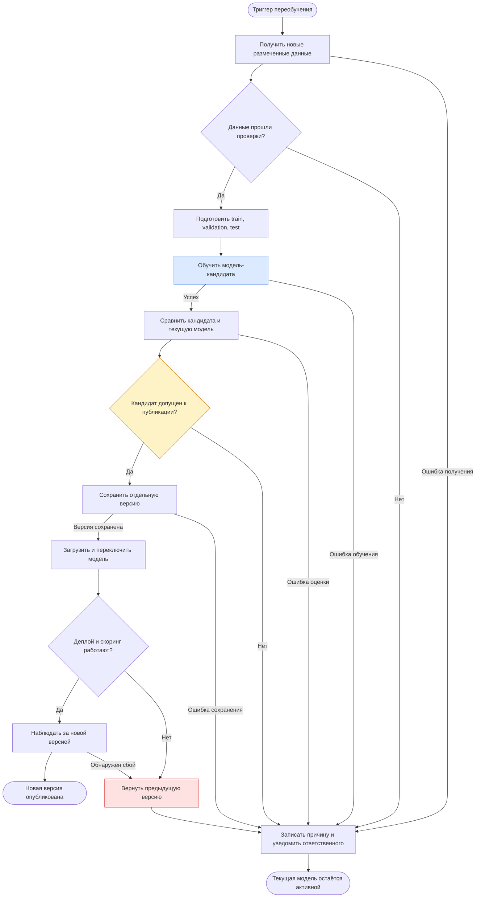

# Процесс автоматического переобучения модели

Цель процесса — обновлять модель прогнозирования оттока при появлении новых данных и публиковать новую версию только после проверки её качества и работоспособности.

Это предлагаемый процесс автоматизации для проекта. Сейчас реализованы подготовка данных, обучение baseline и AutoML, расчёт метрик и сохранение артефактов. Планировщик, получение новых данных из CRM, автоматический допуск к публикации и деплой потребуют отдельной реализации. Диаграмма в Mermaid показывает логику процесса, а не является исполняемым файлом BPMN 2.0.

## Схема процесса



## Этапы и передаваемые результаты

| Этап | Что происходит | Что передаётся дальше |
| --- | --- | --- |
| 1. Триггер | Планировщик запускает процесс, например раз в неделю. Дополнительный повод — снижение качества или изменение распределения входных данных. Для одной версии данных одновременно выполняется один запуск. | Идентификатор запуска, причина запуска и период данных |
| 2. Получение данных | Из CRM и биллинга выгружаются клиентские признаки и подтверждённый исход `Churn`. Для формирования метки должен завершиться заранее заданный период наблюдения. Клиенты с неизвестным исходом пока не используются для обучения. | Снимок данных с версией, датами наблюдений и целевой переменной |
| 3. Проверка данных | Проверяются состав колонок, типы, пропуски, дубликаты, наличие обоих классов и достаточное количество примеров для разделения выборки. Требования к объёму и допустимым пропускам задаются до запуска процесса. | Проверенный набор данных либо отчёт с причиной остановки |
| 4. Подготовка | `TotalCharges` приводится к числу; `customerID` и `Churn` исключаются из признаков. Создаются train, validation и test без пересечения записей. Preprocessing обучается только на train. | Обучающая, валидационная и отложенная выборки из одних и тех же версионированных данных |
| 5. Обучение кандидата | Обучается baseline, затем Optuna подбирает модель и параметры по validation ROC-AUC. Лучшая конфигурация переобучается на train и validation. Результаты сохраняются в отдельный каталог запуска. | Pipeline кандидата с preprocessing, параметры и журнал обучения |
| 6. Проверка качества | Кандидат и действующая модель оцениваются на одном test: ROC-AUC, Accuracy, Precision, Recall и F1-score. Дополнительно проверяется загрузка pipeline и возможность получить корректные прогнозы. | Сравнительный отчёт и результаты технических проверок |
| 7. Решение о публикации | Автоматическая проверка применяет заранее определённые правила допуска. При непрохождении хотя бы одного обязательного условия публикация отклоняется. | Решение «допустить» или «отклонить» с причиной |
| 8. Сохранение версии | Допущенный кандидат сохраняется под уникальной версией вместе с метриками, параметрами, версией данных, Git-коммитом и ссылкой на предыдущую модель. | Полный комплект новой версии и её идентификатор |
| 9. Деплой | Процесс скоринга загружает новую версию, выполняет контрольный прогноз и только затем переключает ссылку на активную модель. Начатые задания завершаются с прежней версией, новые используют новую. | Активная версия модели и журнал публикации |
| 10. Наблюдение и откат | Проверяются ошибки загрузки и прогнозирования, время обработки и выходные значения. После поступления фактического `Churn` оценивается качество. При подтверждённой проблеме возвращается предыдущая версия. | Подтверждение публикации либо запись об откате и уведомление |

## Триггер и подготовка данных

Расписание «раз в неделю» — пример настройки будущего процесса. Само наступление даты не означает обязательную публикацию: если новых размеченных данных недостаточно, запуск завершается без изменения модели. Изменение распределения признаков также служит поводом для проверки, но само по себе не доказывает падение качества.

В текущем CSV нет дат снимков и событий. Для реального переобучения их нужно получать вместе с выгрузкой: признаки должны описывать клиента до прогнозируемого ухода, а более поздний период следует оставлять для test. При повторных наблюдениях одного клиента нужно исключить пересечение одинаковых событий и утечку между выборками. В учебном пайплайне пока используется стратифицированное случайное разделение с `random_state=42`.

Validation используется для подбора параметров и, если требуется, порога решения. Test применяется для итогового сравнения, а не для повторного подбора после неудачной попытки. В последовательных циклах переобучения оценочный период обновляется по мере появления новых подтверждённых исходов.

## Правила допуска новой версии

Для первого варианта автоматизации предлагается простое правило: **ROC-AUC кандидата выше, чем у действующей модели, а Recall и F1-score не ниже** на одной отложенной выборке. Recall важен для удержания: рост качества ранжирования не должен сопровождаться увеличением доли пропущенных уходов.

При сравнении используется одна заранее зафиксированная политика выбора порога; пороги не подбираются на test. Если действующей версии ещё нет, кандидат сравнивается с baseline. Если кандидат не выигрывает, текущая модель остаётся в работе; при первом запуске публикация откладывается.

Кроме метрик, обязательны успешная загрузка сохранённого pipeline, совместимость входных колонок и корректные вероятности класса `Yes` в диапазоне от 0 до 1. Ошибка вычисления метрики или технической проверки означает отказ в публикации. Приведённое правило допуска предлагается для схемы; в текущем коде оно ещё не реализовано.

## Сохранение и деплой

Для учебного проекта достаточно версионированного хранилища файлов, без отдельного реестра моделей. Предлагаемая структура:

```text
artifacts/runs/<run_id>/           # черновые результаты обучения
artifacts/releases/<version>/     # допущенные версии
    model.joblib
    metrics.json
    params.json
    metadata.json                # данные, Git-коммит, дата, предыдущая версия
```

Каталоги размещаются в постоянном хранилище среды запуска и сохраняются между запусками и заменой контейнеров. Файлы модели не требуется добавлять в Git. MLflow можно использовать для связи версии с экспериментом; действующая интеграция MLflow логирует артефакты, но не выполняет регистрацию и публикацию модели.

Ссылка `active_version` в настройках процесса скоринга переключается только после сохранения полной версии и успешной загрузки. Предыдущий комплект остаётся доступным для отката. В текущем проекте путь `artifacts/models/best_model.joblib` перезаписывается при обучении; автоматическому процессу нужно задавать отдельные пути для каждого запуска, чтобы кандидат не заменял активную модель заранее.

Под деплоем здесь понимается передача pipeline в процесс пакетного скоринга клиентов, описанный в [Model_BPMN.md](Model_BPMN.md). Для этого сценария отдельный HTTP API не требуется. Текущий Dockerfile запускает обучение и сам по себе деплой скоринга не реализует.

## Действия при неуспехе

- Ошибка получения или подготовки данных, обучения, оценки либо сохранения: запуск получает статус ошибки, действующая модель не меняется. Причина сохраняется в журнале и передаётся ответственному.
- Недостаточное качество: кандидат сохраняется как результат эксперимента без допуска к публикации. Новый запуск выполняется после исправления причины или поступления подходящих данных.
- Ошибка деплоя или последующего скоринга: переключение отменяется либо восстанавливается предыдущая версия; фиксируются причина и затронутые задания для повторной обработки. При отсутствии предыдущей версии скоринг не запускается.

Характеристики и ограничения модели: [model_card.md](model_card.md).
