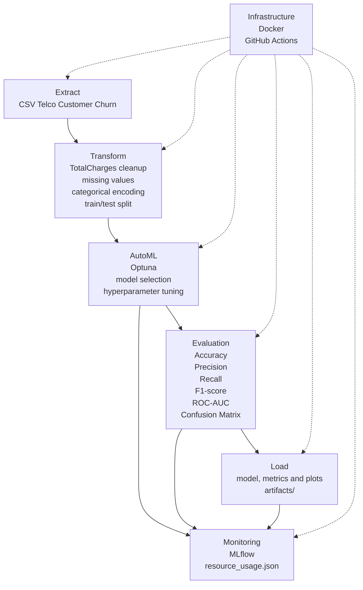

# AutoML-пайплайн для прогнозирования оттока клиентов телеком-компании

Автор: `kropachev`

## Описание проекта

Это учебный итоговый проект по AutoML на датасете Telco Customer Churn. Цель проекта — построить воспроизводимый ML-пайплайн, который прогнозирует риск оттока клиента телеком-компании.


## Бизнес-задача

Телеком-компания хочет заранее находить клиентов, которые могут отказаться от услуг. Если таких клиентов определить до ухода, бизнес может предложить им скидку, другой тариф, персональное предложение или дополнительную поддержку.

Практический результат для бизнеса — список клиентов с высоким риском оттока и вероятность оттока для каждого клиента. Это помогает точнее направлять удерживающие кампании.

## ML-задача

ML-задача — бинарная классификация.

Модель по данным клиента прогнозирует целевую переменную `Churn`:

- `Yes` — клиент ушел;
- `No` — клиент остался.

Основная метрика для подбора AutoML-модели — `ROC-AUC`, потому что она показывает, насколько хорошо модель разделяет клиентов с оттоком и без оттока при разных порогах.

Дополнительно считаются:

- `Accuracy`;
- `Precision`;
- `Recall`;
- `F1-score`.

## Датасет Telco Customer Churn

В проекте используется готовый CSV-файл Telco Customer Churn из Kaggle или IBM Sample Data:

`data/telco_customer_churn.csv`

В датасете 7043 строки и 21 колонка. Каждая строка описывает одного клиента телеком-компании.

Основные группы признаков:

- демография: `gender`, `SeniorCitizen`, `Partner`, `Dependents`;
- информация о клиенте: `tenure`, `Contract`, `PaymentMethod`, `PaperlessBilling`;
- подключенные услуги: `PhoneService`, `InternetService`, `OnlineSecurity`, `TechSupport`, `StreamingTV`, `StreamingMovies`;
- платежи: `MonthlyCharges`, `TotalCharges`;
- целевая переменная: `Churn`.

Распределение целевой переменной:

| Churn | Количество клиентов |
| --- | ---: |
| No | 5174 |
| Yes | 1869 |

Класс `Yes` меньше класса `No`, поэтому при интерпретации результата важно смотреть не только на `Accuracy`, но и на `Recall`, `Precision`, `F1-score` и `ROC-AUC`.

## ETL

ETL реализован в [src/data.py](/Users/kropachev/Projects/netology_automl/src/data.py).

### Extract

Данные загружаются из готового CSV-файла:

`data/telco_customer_churn.csv`

### Transform

На этапе очистки выполняются простые и понятные преобразования:

- колонка `TotalCharges` приводится к числовому типу;
- некорректные значения в `TotalCharges` заменяются на `NaN`;
- пропуски в `TotalCharges` заполняются медианой;
- целевая переменная `Churn` отделяется от признаков;
- колонка `customerID` удаляется из признаков, потому что это технический идентификатор клиента.

Дальше preprocessing выполняется внутри `sklearn Pipeline`:

- числовые признаки: заполнение пропусков медианой и `StandardScaler`;
- категориальные признаки: заполнение самым частым значением и `OneHotEncoder`;
- объединение обработки через `ColumnTransformer`.

### Load

Краткая информация о датасете сохраняется в:

`artifacts/dataset_info.json`

Туда записываются количество строк, количество колонок, список колонок и распределение `Churn`.

## Схема ML-пайплайна



Пайплайн начинается с загрузки CSV-файла. Затем данные очищаются, признаки подготавливаются, обучается baseline-модель и запускается AutoML-подбор. После обучения сохраняются модель, метрики, параметры, графики и данные мониторинга.

## Baseline-модель

Baseline нужен как простая точка сравнения. Он показывает, какого качества можно добиться без подбора разных моделей и гиперпараметров.

Baseline реализован в [src/pipeline.py](/Users/kropachev/Projects/netology_automl/src/pipeline.py) и [src/train.py](/Users/kropachev/Projects/netology_automl/src/train.py).

Архитектура baseline:

1. `ColumnTransformer` для раздельной обработки числовых и категориальных признаков.
2. `SimpleImputer`, `StandardScaler` для числовых признаков.
3. `SimpleImputer`, `OneHotEncoder` для категориальных признаков.
4. `LogisticRegression` как классификатор.

Артефакты baseline:

- `artifacts/models/baseline_model.joblib`;
- `artifacts/baseline_metrics.json`;
- базовые графики в `artifacts/plots/`.

## AutoML-подход

AutoML реализован в [src/automl.py](/Users/kropachev/Projects/netology_automl/src/automl.py) через `Optuna`.

AutoML не заменяет весь код проекта, а автоматизирует только выбор модели и гиперпараметров. Preprocessing остается общим и таким же понятным, как в baseline.

Кандидаты моделей:

- `LogisticRegression`;
- `RandomForestClassifier`;
- `GradientBoostingClassifier`.

Как работает подбор:

1. Данные делятся на train/test.
2. Train дополнительно делится на train/validation.
3. Optuna запускает несколько trial.
4. В каждом trial выбирается модель и набор гиперпараметров.
5. Модель оценивается по validation `ROC-AUC`.
6. Лучшая конфигурация обучается на полном train.
7. Финальное качество считается на test set.

Лучшая найденная модель:

`RandomForestClassifier`

Лучшие параметры:

| Параметр | Значение |
| --- | ---: |
| `n_estimators` | 140 |
| `max_depth` | 4 |
| `min_samples_split` | 3 |
| `min_samples_leaf` | 1 |

Validation `ROC-AUC`: `0.83497`.

## Архитектура финальной модели

Финальная модель сохранена как единый `sklearn Pipeline`:

1. `preprocessing`
   - числовые признаки: median imputer + scaler;
   - категориальные признаки: most frequent imputer + one-hot encoding.
2. `model`
   - `RandomForestClassifier` с параметрами, выбранными Optuna.

Такой формат удобен для повторного использования: при загрузке `artifacts/models/best_model.joblib` модель уже содержит и подготовку признаков, и классификатор.

## Полученные метрики

Метрики baseline на test set:

| Метрика | Значение |
| --- | ---: |
| Accuracy | 0.8055 |
| Precision | 0.6572 |
| Recall | 0.5588 |
| F1-score | 0.6040 |
| ROC-AUC | 0.8419 |

Метрики лучшей AutoML-модели на test set:

| Метрика | Значение |
| --- | ---: |
| Accuracy | 0.7892 |
| Precision | 0.6860 |
| Recall | 0.3797 |
| F1-score | 0.4888 |
| ROC-AUC | 0.8371 |

В этом запуске AutoML выбрал `RandomForestClassifier`. По `ROC-AUC` результат близок к baseline, но baseline `LogisticRegression` лучше по `Recall` и `F1-score`. Для бизнес-задачи удержания клиентов это важно: высокий `Recall` помогает находить больше клиентов, которые реально могут уйти.

## Визуализации

Графики сохраняются в `artifacts/plots/`.

Основные графики:

- [Распределение Churn](artifacts/plots/churn_distribution.png) — баланс классов `Yes` и `No`;
- [MonthlyCharges по Churn](artifacts/plots/monthly_charges_by_churn.png) — сравнение ежемесячных платежей для ушедших и оставшихся клиентов;
- [Confusion matrix](artifacts/plots/confusion_matrix.png) — ошибки и верные ответы классификации;
- [ROC curve](artifacts/plots/roc_curve.png) — качество разделения классов при разных порогах.

AutoML-графики:

- [Feature importance](artifacts/plots/feature_importance.png) — признаки, которые сильнее всего влияют на прогноз финальной модели;
- [Optuna optimization history](artifacts/plots/optuna_history.png) — история подбора Optuna по validation `ROC-AUC`.

Эти визуализации помогают проверить не только итоговые числа, но и поведение модели: баланс классов, ошибки классификации, качество ранжирования клиентов и важные признаки.

## Мониторинг через MLflow и psutil

MLflow-логирование реализовано в [src/tracking.py](/Users/kropachev/Projects/netology_automl/src/tracking.py).

В MLflow логируются:

- выбранная AutoML-модель;
- гиперпараметры;
- validation `ROC-AUC`;
- test-метрики;
- JSON-артефакты;
- графики;
- сохраненная модель.

Если MLflow недоступен, обучение не падает. Проект просто пропускает MLflow-логирование и продолжает сохранять локальные артефакты.

Ресурсный мониторинг реализован в [src/monitor.py](/Users/kropachev/Projects/netology_automl/src/monitor.py) через `psutil`.

После AutoML-запуска сохраняется:

`artifacts/resource_usage.json`

Текущий пример ресурсных метрик:

| Метрика | Значение |
| --- | ---: |
| Время обучения, сек | 0.69 |
| CPU, % | 541.3 |
| RAM, MB | 267.23 |

Это простой мониторинг для учебного проекта. Он показывает примерную нагрузку обучения без отдельной системы observability.

Запуск MLflow UI:

```bash
mlflow ui --backend-store-uri mlruns --host 127.0.0.1 --port 5000
```

После запуска UI доступен по адресу:

`http://127.0.0.1:5000`

## Тестирование

Тесты находятся в `tests/` и запускаются через `pytest`.

Проверяется:

- загрузка CSV-данных;
- очистка `TotalCharges`;
- подготовка `X` и `y`;
- создание baseline pipeline;
- обучение baseline на маленьком примере;
- расчет метрик в диапазоне от 0 до 1;
- сохранение baseline-модели, метрик и графиков;
- запуск AutoML на малом числе trial;
- сохранение лучшей AutoML-модели, параметров, метрик и графиков;
- сохранение `resource_usage.json`;
- устойчивое поведение MLflow-логирования.

Локальный запуск тестов:

```bash
pytest
```

Если используется виртуальное окружение проекта:

```bash
.venv/bin/pytest
```

## Docker

Dockerfile находится в корне проекта: [Dockerfile](/Users/kropachev/Projects/netology_automl/Dockerfile).

Образ использует `python:3.11-slim`, устанавливает зависимости из `requirements.txt` и запускает обучение командой:

```bash
python -m src.train --automl-trials 20
```

Сборка образа:

```bash
docker build -t netology-automl .
```

Запуск обучения в контейнере:

```bash
docker run --rm netology-automl
```

Быстрый smoke-запуск с малым числом AutoML trials:

```bash
docker run --rm netology-automl --automl-trials 2
```

## CI/CD

CI/CD реализован через GitHub Actions:

`.github/workflows/ci.yml`

Workflow запускается на `push` и `pull_request`.

Что делает CI:

1. Забирает репозиторий.
2. Устанавливает Python 3.12.
3. Устанавливает зависимости из `requirements.txt`.
4. Запускает `pytest`.

CI не запускает тяжелое обучение и не собирает Docker-образ. Для учебного проекта этого достаточно: автоматические проверки быстро ловят ошибки в ETL, pipeline, AutoML, MLflow-логировании, мониторинге и графиках.

## Инструкция запуска проекта

Установка зависимостей:

```bash
python -m venv .venv
source .venv/bin/activate
pip install -r requirements.txt
```

Запуск полного обучения baseline + AutoML:

```bash
python -m src.train --automl-trials 20
```

Быстрый запуск для проверки:

```bash
python -m src.train --automl-trials 2
```

После запуска результаты будут сохранены в `artifacts/`:

- `artifacts/baseline_metrics.json`;
- `artifacts/best_metrics.json`;
- `artifacts/best_params.json`;
- `artifacts/resource_usage.json`;
- `artifacts/models/baseline_model.joblib`;
- `artifacts/models/best_model.joblib`;
- `artifacts/plots/*.png`.

Запуск тестов:

```bash
.venv/bin/pytest
```

## Структура репозитория

```text
.
├── src/                 # исходный код ML-пайплайна
│   ├── data.py          # загрузка, очистка и подготовка данных
│   ├── pipeline.py      # preprocessing и baseline pipeline
│   ├── train.py         # запуск baseline и AutoML-обучения
│   ├── automl.py        # Optuna AutoML
│   ├── visualize.py     # графики для отчета
│   ├── tracking.py      # MLflow-логирование
│   └── monitor.py       # psutil-мониторинг ресурсов
├── tests/               # pytest-тесты
├── data/                # CSV-данные
├── artifacts/           # модели, метрики, графики и JSON-артефакты
│   ├── models/          # сохраненные модели
│   └── plots/           # графики
├── notebooks/           # место для исследовательских ноутбуков
├── .github/workflows/   # GitHub Actions CI
├── Dockerfile           # Docker-образ для запуска обучения
├── requirements.txt     # зависимости проекта
├── pytest.ini           # настройки pytest
└── README.md            # итоговый отчет
```

## Выводы для бизнеса

Модель может использоваться как первый прототип для поиска клиентов с риском оттока. Она уже умеет выдавать вероятность оттока и может помочь приоритизировать клиентов для удержания.

По текущим метрикам baseline `LogisticRegression` выглядит более полезным для задачи удержания, потому что лучше находит клиентов с оттоком по `Recall` и `F1-score`. AutoML-модель дает похожий `ROC-AUC`, но хуже находит положительный класс при стандартном пороге.

Для бизнеса это означает:

- модель можно использовать как учебный прототип скоринга оттока;
- перед реальным применением нужно подобрать decision threshold под стоимость ошибок;
- если важнее не пропустить уходящих клиентов, стоит оптимизировать `Recall`;
- если удерживающие предложения дорогие, нужно следить за `Precision`;
- следующие улучшения стоит начинать с анализа порога классификации, class weights и дополнительных признаков.

Итог: проект показывает полный путь от CSV-данных до обученной модели, метрик, графиков, мониторинга и автоматических тестов.
